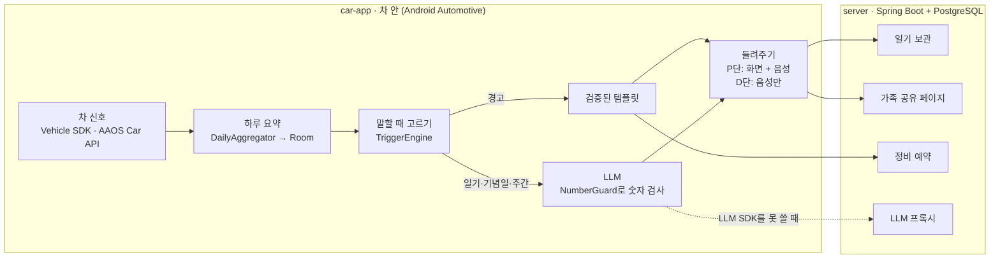

# 붕붕일기

차가 1인칭으로 하루를 들려주는 Pleos Connect 앱이에요. 경고등은 사람 말로 바꿔 알려주고, 정비 예약과 가족 공유까지 이어줘요.

2026 현대자동차·기아 차량용 앱 개발 공모전(Pleos Playground) 출품작입니다.

> "오늘은 너랑 37.2km 달렸어. 아침부터 비가 와서 와이퍼를 41분이나 흔들었더니 팔이 뻐근해."

## 왜 만드나

- 경고등이 뜨면 무슨 뜻인지, 얼마나 급한지 몰라 당황하는 운전자가 많아요.
- 차 상태는 운전하는 사람만 알고, 같이 타는 가족은 몰라요.
- 붕붕일기는 차가 아는 데이터로 차가 직접 말하게 해요. **숫자는 차 데이터에서만 가져오고, AI는 말투만 입혀요.**

## 주요 기능

| 기능 | 하는 일 | 언제 나오나 |
| --- | --- | --- |
| 첫 실행 세팅 | 닉네임 정하기, 말투 고르기, 차 상태 불러오기, 가족 카카오톡 연결 | 앱을 처음 켤 때 (주차 중) |
| 닉네임과 말투 | "킹카"로 정하면 앱 안 제목이 "킹카 일기"가 돼요. 말투는 친구·집사·무뚝뚝 | 첫 실행 세팅, 설정 화면 |
| 오늘의 일기 | 차가 1인칭으로 오늘 주행을 들려줘요 | 주행을 끝내고 기어를 P에 놓을 때 |
| 경고 통역과 정비 예약 | 경고를 "급한 정도 / 무슨 뜻 / 할 일"로 풀고 정비소 예약까지 이어줘요 | 경고가 뜨는 즉시 |
| 주행 중 음성 모드 | 글을 숨기고 경고만 음성으로 알려줘요 | 기어가 D일 때 |
| 기념일 | 1만 km 돌파, 출고 1주년을 축하해요 | 기준을 넘는 순간 |
| 가족 주간 일기 | 한 주 요약을 연결된 가족의 카카오톡으로 보내요 | 일요일 밤 |
| 일기장·차 건강 | 지난 일기와 바퀴별 공기압, 경고등, 예약 상태를 모아봐요 | 아무 때나 |

## 구조



설계 원칙:

1. **숫자는 데이터가, 말투는 AI가.** LLM 출력에 요약 데이터에 없는 숫자가 있으면 버리고 템플릿 문장을 써요.
2. **경고는 검증된 템플릿만.** 정비 안내가 틀리면 안 되니까 경고 문장엔 LLM을 쓰지 않아요.
3. **운전 중엔 화면 대신 목소리.** `CarUxRestrictions`를 따라 주행 중엔 글을 숨겨요.
4. **위치와 경로는 밖으로 보내지 않아요.** 서버와 가족 공유엔 숫자와 차의 말만 가요.

## 저장소 구조

```
bungbung/
├─ car-app/            Android Automotive 앱 (Phase 0에서 생성)
├─ server/             Spring Boot 서버 (Phase 5에서 생성)
├─ docs/
│  ├─ api-findings.md  Pleos API 조사 결과
│  ├─ decisions.md     임계값과 설계 결정 기록
│  └─ demo-script.md   PT 시연 순서
├─ docker-compose.yml  로컬 PostgreSQL
├─ PROMPT.md           AI 코딩 도구용 단계별 개발 명세
└─ README.md
```

## 기술 스택

| 영역 | 사용 기술 |
| --- | --- |
| 차 앱 | Kotlin, Jetpack Compose, Coroutines/Flow, Room, Pleos Connect SDK(Vehicle, TextToSpeech), AAOS Car API |
| 서버 | Java 21, Spring Boot 3, Spring Data JPA, PostgreSQL, Flyway, springdoc-openapi |
| 테스트 | JUnit, Testcontainers |
| 개발 환경 | Android Studio + Pleos Connect Emulator(API 34), Docker |

## 시작하기

### 준비물

- Pleos Playground 계정, My Project 생성과 SDK 사용 신청 ([안내](https://document.pleos.ai/en/docs/pleos-only/create-my-project))
- Android Studio, JDK 21, Docker Desktop
- Pleos Connect 에뮬레이터 ([환경 설정 가이드](https://document.pleos.ai/en/docs/connect/guide/getting-started/application-development/setup-connect-sdk-emulator))
  1. SDK 신청 후 받은 시스템 이미지 URL을 Android Studio의 SDK Update Sites에 추가
  2. API 34 Pleos Connect 시스템 이미지 설치
  3. Automotive AVD 생성 (Cold boot, RAM 4GB)

### 서버 실행

```cmd
docker compose up -d
cd server
gradlew.bat bootRun
```

API 문서는 서버 실행 후 `http://localhost:8080/swagger-ui.html`에서 볼 수 있어요.

### 차 앱 실행

에뮬레이터를 켠 상태에서:

```cmd
cd car-app
gradlew.bat installDebug
```

macOS나 Linux에서는 `gradlew.bat` 대신 `./gradlew`를 쓰면 돼요.

## 개발 진행

[PROMPT.md](PROMPT.md)에 단계별 개발 명세가 있어요. AI 코딩 도구에게 한 단계씩 시키고, 끝날 때마다 아래를 체크해요.

- [ ] Phase 0. 환경과 Pleos API 조사 → `docs/api-findings.md`
- [ ] Phase 1. 차 앱 뼈대, Fake 데이터, 화면
- [ ] Phase 1-B. 첫 실행 세팅 (닉네임, 차 상태 불러오기, 가족 연결 화면)
- [ ] Phase 2. 실제 차 신호 연결, 운전 중 제한
- [ ] Phase 3. 음성 (TextToSpeech)
- [ ] Phase 4. 문장 생성 (LLM + 숫자 검사 + 템플릿 대체)
- [ ] Phase 5. 서버 (일기 보관, 가족 공유, 정비 예약)
- [ ] Phase 5-B. 가족 연결과 카카오톡 (QR 연결, 카카오 로그인, 주간 일기 발송)
- [ ] Phase 6. 시연 준비

## 일정

| 날짜 | 할 일 |
| --- | --- |
| 11월 15일 | 공모전 참가 신청과 기획안 제출 마감 |
| 11월 23일 | 1차 서류 심사 결과 |
| 12월 3~4일 | 2차 최종 PT 심사 (오프라인, 앱 시연) |

## 팀

| 이름 | 역할 |
| --- | --- |
|  | 차 앱 (Kotlin, Android Automotive) |
|  | 서버 (Spring Boot, PostgreSQL) |
|  | 기획서, PT 자료 |

## 참고 문서

- [Pleos Connect 시작 가이드](https://document.pleos.ai/en/docs/pleos-only/getting-started)
- [Vehicle SDK](https://document.pleos.ai/en/docs/pleos-only/connect-sdk-pleos/Vehicle/intro)
- [TextToSpeech SDK](https://document.pleos.ai/en/docs/pleos-only/connect-sdk-pleos/TextToSpeech/intro)
- [Driving Restriction 가이드](https://document.pleos.ai/en/docs/pleos-only/vehicle-app-developer-guide/driving-restriction-development-guide)
- [앱 심사 가이드](https://document.pleos.ai/en/docs/pleos-only/distribute/app-review-guide)
