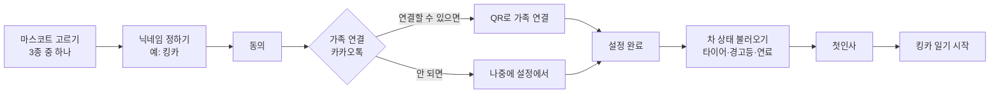
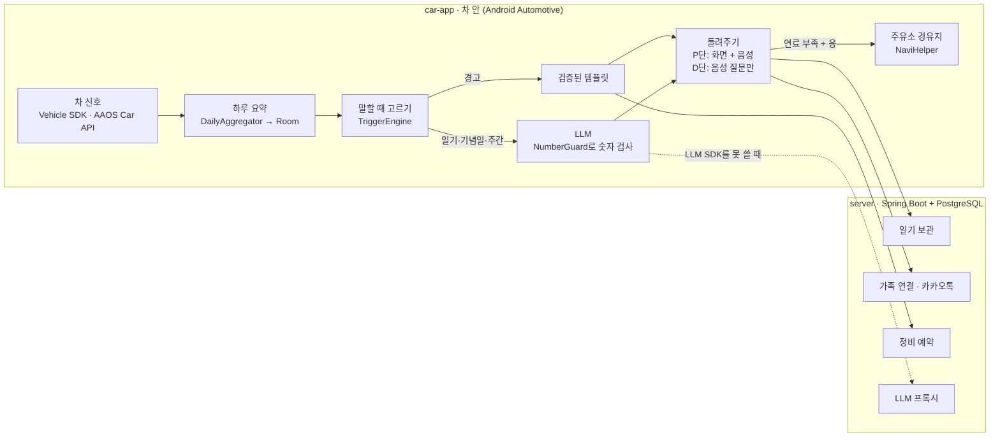

# 붕붕일기

차의 마스코트가 1인칭으로 하루를 들려주는 Pleos Connect 앱이에요. 경고등은 사람 말로 바꿔 알려주고, 정비 예약, 주유소 경유지, 가족 공유까지 이어줘요.

2026 현대자동차·기아 차량용 앱 개발 공모전(Pleos Playground) 출품작입니다.

> "오늘은 너랑 37.2km 달렸어. 아침부터 비가 와서 와이퍼를 41분이나 흔들었더니 팔이 뻐근해."

## 왜 만드나

- 경고등이 뜨면 무슨 뜻인지, 얼마나 급한지 몰라 당황하는 운전자가 많아요.
- 차 상태는 운전하는 사람만 알고, 같이 타는 가족은 몰라요.
- 붕붕일기는 차가 아는 데이터로 차가 직접 말하게 해요. **숫자는 차 데이터에서만 가져오고, AI는 말투만 입혀요.**

## 처음 켜면



설정이 끝나면 차의 현재 상태를 불러오고, 마스코트가 그 결과로 첫인사를 해요. 그 순간부터 앱 안 제목은 "킹카 일기"가 돼요.

| 마스코트 | 생김새 | 성격 (기본 말투) | 자기소개 |
| --- | --- | --- | --- |
| 꼬마차 | 동글동글한 민트색 꼬마 자동차 | 다정하고 장난스러움 (친구) | 안녕! 나랑 같이 달리면 매일 재밌는 얘기 해줄게. |
| 부엉이 | 동그란 안경과 나비넥타이를 한 부엉이 | 정중하고 차분함 (집사) | 안녕하십니까. 매일의 주행을 차분히 정리해 드리겠습니다. |
| 곰 | 정비 모자를 쓴 무표정한 곰 | 짧고 담백함 (무뚝뚝) | 안녕. 필요한 말만 한다. |

말투는 마스코트를 고르면 정해지고, 설정에서 따로 바꿀 수 있어요.

## 주요 기능

| 기능 | 하는 일 | 언제 나오나 |
| --- | --- | --- |
| 오늘의 일기 | 마스코트가 1인칭으로 오늘 주행을 들려줘요 | 주행을 끝내고 기어를 P에 놓을 때 |
| 경고 통역 | 타이어, 엔진, 연료, 엔진오일 경고를 "급한 정도 / 무슨 뜻 / 할 일"로 풀어줘요 | 경고가 뜨는 즉시 |
| 정비소 예약 | 가까운 정비소와 시간을 골라 예약을 요청해요 | 타이어·엔진·엔진오일 경고에서 |
| 주유소 경유지 | 가까운 주유소를 내비 경유지로 넣어줘요 | 연료가 부족할 때 |
| 주행 중 음성 모드 | 글을 숨기고 짧게 물어봐요. "응/아니"로 답하면 돼요 | 기어가 D일 때 |
| 기념일 | 1만 km 돌파, 출고 1주년을 축하해요 | 기준을 넘는 순간 |
| 가족 주간 일기 | 한 주 요약을 연결된 가족의 카카오톡으로 보내요 | 일요일 밤 |
| 일기장·차 건강 | 지난 일기와 바퀴별 공기압, 경고, 예약 상태를 모아봐요 | 아무 때나 |

## 구조



설계 원칙:

1. **숫자는 데이터가, 말투는 AI가.** LLM 출력에 요약 데이터에 없는 숫자가 있으면 버리고 템플릿 문장을 써요.
2. **경고는 검증된 템플릿만.** 정비 안내가 틀리면 안 되니까 경고 문장엔 LLM을 쓰지 않아요.
3. **운전 중엔 화면 대신 목소리.** `CarUxRestrictions`를 따라 주행 중엔 글을 숨겨요.
4. **위치와 경로는 밖으로 보내지 않아요.** 서버와 가족에겐 숫자와 마스코트의 말만 가요.
5. **차와 서버 없이도 돌아가요.** 모든 외부 기능에 Fake 구현이 있어서 시연이 끊기지 않아요.

## 저장소 구조

```
bungbung-diary/
├─ car-app/            Android Automotive 앱 (Kotlin, Jetpack Compose)
├─ server/             Spring Boot 서버 (Phase 6에서 생성)
├─ docs/
│  ├─ api-findings.md  Pleos·카카오 API 조사 결과
│  ├─ decisions.md     임계값과 설계 결정 기록
│  └─ demo-script.md   PT 시연 순서
├─ docker-compose.yml  로컬 PostgreSQL
├─ CLAUDE.md           AI 코딩 도구가 항상 지킬 규칙
├─ PROMPT.md           단계별 개발 명세
└─ README.md
```

## 기술 스택

| 영역 | 사용 기술 |
| --- | --- |
| 차 앱 | Kotlin, Jetpack Compose, Coroutines/Flow, DataStore, Room, Pleos Connect SDK(Vehicle, TextToSpeech, SpeechToText, NaviHelper), AAOS Car API |
| 서버 | Java 21, Spring Boot 3, Spring Data JPA, PostgreSQL, Flyway, springdoc-openapi |
| 연동 | 카카오 로그인, 카카오톡 메시지(나에게 보내기), 카카오톡 공유 |
| 테스트 | JUnit, Testcontainers, GitHub Actions |
| 개발 환경 | Android Studio + Pleos Connect Emulator(API 34), Docker |

## 시작하기

### 준비물

- Android Studio, JDK 21, Docker Desktop
- Pleos Playground 계정, My Project 생성과 SDK 사용 신청 ([안내](https://document.pleos.ai/en/docs/pleos-only/create-my-project))
- Pleos Connect 에뮬레이터 ([환경 설정 가이드](https://document.pleos.ai/en/docs/connect/guide/getting-started/application-development/setup-connect-sdk-emulator))
  1. SDK 신청 후 받은 시스템 이미지 URL을 Android Studio의 SDK Update Sites에 추가
  2. API 34 Pleos Connect 시스템 이미지 설치
  3. Automotive AVD 생성 (Cold boot, RAM 4GB)

### 차 앱 실행

1. Android Studio에서 **File > Open**으로 `car-app` 폴더를 열어요. 저장소 최상위 폴더가 아니에요.
2. Gradle Sync가 끝나면 가로 화면 에뮬레이터를 고르고 Run 'app'을 눌러요.

명령줄에서는:

```cmd
cd car-app
gradlew.bat installDebug
```

에뮬레이터에 한글 닉네임을 바로 넣고 싶으면:

```cmd
adb shell am start -S -n com.bungbung.diary/.MainActivity --es nickname 킹카
```

macOS나 Linux에서는 `gradlew.bat` 대신 `./gradlew`를 써요.

### 서버 실행 (Phase 6 이후)

```cmd
docker compose up -d
cd server
gradlew.bat bootRun
```

API 문서는 서버 실행 후 `http://localhost:8080/swagger-ui.html`에서 볼 수 있어요.

## 개발 진행

[PROMPT.md](PROMPT.md)에 단계별 개발 명세가 있어요. AI 코딩 도구를 쓸 땐 [CLAUDE.md](CLAUDE.md)의 규칙을 함께 따르게 해요.

- [x] 개발 명세와 문서 템플릿
- [x] 차 앱 기본 화면 뼈대 (#3)
- [ ] Phase 0. 환경과 Pleos API 조사 → `docs/api-findings.md`
- [ ] **Phase 1. 첫 실행 프로토타입** (마스코트, 닉네임, 가족 연결 선택, 차 상태 불러오기, 홈 시작 화면)
- [ ] Phase 2. 핵심 기능 정리 (템플릿 엔진, 저장, 경고·예약·경유지·기념일)
- [ ] Phase 3. 실제 차 신호 연결, 운전 중 제한
- [ ] Phase 4. 음성 (TextToSpeech, "응/아니" 답)
- [ ] Phase 5. 문장 생성 (LLM + 숫자 검사 + 템플릿 대체)
- [ ] Phase 6. 서버 (프로필, 일기 보관, 정비 예약)
- [ ] Phase 7. 가족 연결과 카카오톡
- [ ] Phase 8. 시연 준비

## 협업 방식

1. `main`에서 새 브랜치를 만들어요. 예: `feat/phase1-first-run`
2. 작업하고 커밋한 뒤 GitHub에 올려 PR을 열어요.
3. 팀원 한 명이 확인하고 합쳐요. `main`에 직접 올리지 않아요.

## 일정

| 날짜 | 할 일 |
| --- | --- |
| 11월 15일 | 공모전 참가 신청과 기획안 제출 마감 |
| 11월 23일 | 1차 서류 심사 결과 |
| 12월 3~4일 | 2차 최종 PT 심사 (오프라인, 앱 시연) |

## 팀

| 이름 | 역할 |
| --- | --- |
|  | 차 앱 (Kotlin, Android Automotive) |
|  | 서버 (Spring Boot, PostgreSQL) |
|  | 기획서, PT 자료, 마스코트 디자인 |

## 참고 문서

- [Pleos Connect 시작 가이드](https://document.pleos.ai/en/docs/pleos-only/getting-started)
- [Vehicle SDK](https://document.pleos.ai/en/docs/pleos-only/connect-sdk-pleos/Vehicle/intro)
- [TextToSpeech SDK](https://document.pleos.ai/en/docs/pleos-only/connect-sdk-pleos/TextToSpeech/intro)
- [Driving Restriction 가이드](https://document.pleos.ai/en/docs/pleos-only/vehicle-app-developer-guide/driving-restriction-development-guide)
- [앱 심사 가이드](https://document.pleos.ai/en/docs/pleos-only/distribute/app-review-guide)
- [카카오톡 공유 JavaScript](https://developers.kakao.com/docs/latest/ko/kakaotalk-share/js-link)
- [카카오톡 메시지](https://developers.kakao.com/docs/latest/message)
